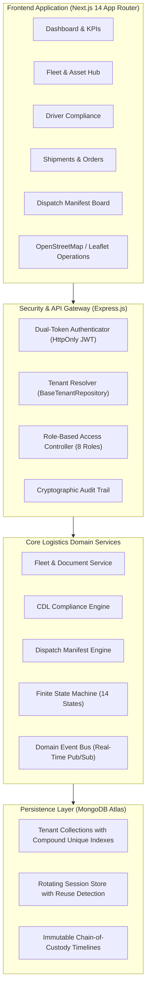

# FleetOS — Enterprise Fleet & Logistics Management SaaS

<div align="center">


**An enterprise-grade, multi-tenant fleet operations, driver compliance, freight orders, and dispatch execution platform.**

[Live Architecture](#architecture--system-design) • [Modules & Features](#core-platform-modules) • [Security & RBAC](#multi-tenant-isolation--rbac) • [Getting Started](#getting-started) • [Test Suite](#automated-test-suites)

</div>

---

## 🌟 Executive Summary

**FleetOS** is a carrier-grade fleet management and logistics dispatch SaaS architected for commercial freight haulers, delivery enterprises, and 3PL carriers. It replaces fragmented legacy trucking software with a unified, secure, real-time operating system.

Engineered with a **modular monolith** topology, FleetOS guarantees **strict multi-tenant database isolation**, deterministic shipment lifecycle transitions via finite state machines, conflict-free atomic vehicle/driver dispatch bindings, and cryptographic dual-token session security.

---

## 🏗 Architecture & System Design



---

## 🚀 Core Platform Modules

### 1. Fleet & Asset Management (Phase 04)
- **Asset Specifications**: Complete tracking for Semi-Trucks, Box Trucks, Flatbeds, and Cargo Vans (VIN, plate, model, year, capacity kg, odometer).
- **Compliance Vault**: Digital compliance document management (DOT Inspection, Commercial Registration, Insurance, Lease Agreements) with automated expiry tracking.
- **Operational Statuses**: Strict transitions (`AVAILABLE`, `ASSIGNED`, `IN_TRANSIT`, `MAINTENANCE`, `OUT_OF_SERVICE`, `RETIRED`).
- **Asset Conflict Guards**: Prevents placing active or assigned vehicles into maintenance or service retirement.

### 2. Driver & CDL Compliance Management (Phase 04)
- **CDL Validation**: Validates Class A/B/C commercial licenses, state issuing authorities, and expiration dates.
- **Driver Status Control**: Regulates on-duty status (`AVAILABLE`, `ASSIGNED`, `ON_DUTY`, `OFF_DUTY`, `ON_LEAVE`, `SUSPENDED`).
- **Safety & Duty Metrics**: Integrated driver safety scoring and real-time duty status logging.

### 3. Customer & Commercial Freight Orders (Phase 05)
- **Tenant-Scoped Customer CRM**: Dedicated individual, business, and enterprise shipping account directories.
- **Human-Readable Tracking Codes**: Unique auto-generated tracking numbers in `FOS-[YYMM]-[HEX6]` format with collision retry guards.
- **Cargo Categorization**: Specialized classification for General Freight, Perishables, HAZMAT, Electronics, Fragile Goods, and Heavy Machinery.
- **Immutable Milestones**: Chronological chain-of-custody recording every state change, actor ID, and operational note.

### 4. Finite State Machine & Lifecycle (Phase 05)
Centralized state machine enforcing 14 distinct states and blocking illegal transitions:
- `DRAFT` ➔ `CONFIRMED` ➔ `READY_FOR_DISPATCH` ➔ `DISPATCHED` ➔ `IN_TRANSIT` ➔ `ARRIVED_AT_DESTINATION` ➔ `OUT_FOR_DELIVERY` ➔ `DELIVERED` *(Terminal)*
- **Exceptional States**: `ON_HOLD`, `DELAYED`, `FAILED_DELIVERY`, `CANCELLED`, `RETURNED` (all require documented justification).

### 5. Dispatch Manifest Engine & Conflict Safeguards (Phase 05)
- **Manifest Orchestration**: Generates unified manifests (`DSP-[YYMM]-[HEX6]`) linking vehicles, certified drivers, and consignments.
- **Concurrency Conflict Prevention**:
  - Automatically rejects vehicle assignment if already engaged in an active run.
  - Automatically blocks driver assignment if already assigned or off-duty.
  - Automatically prevents re-dispatching shipments that already possess an active manifest.
- **Lifecycle Execution**: Single-click journey workflows (`/start`, `/complete`, `/cancel`) managing cascaded status transitions and automatic asset release upon completion.

---

## 🛡 Multi-Tenant Isolation & RBAC

### Non-Bypassable Repository Isolation
Every database read, write, update, and aggregation is scoped via `BaseTenantRepository<T>`, which injects verified `organizationId` filters at the query layer:

```typescript
// Automatic tenant scoping guaranteed at the repository query boundary
const shipments = await shipmentRepo.find(req.tenant, { status: 'IN_TRANSIT' });
```

### Granular 8-Tier RBAC Matrix
| Role | Permissions & Responsibilities |
| :--- | :--- |
| **`SUPER_ADMIN`** | Platform-wide root governance (`*`). |
| **`ORGANIZATION_OWNER`** | Full organization governance, billing, member invites, and fleet oversight. |
| **`ADMIN`** | Operational fleet, user, driver, shipment, and dispatch administration. |
| **`FLEET_MANAGER`** | Vehicle fleet inspection, driver records, maintenance, and expense tracking. |
| **`DISPATCHER`** | Shipment order creation, dispatch manifest execution, and route coordination. |
| **`DRIVER`** | Read assigned runs, execute delivery milestones, and submit expense logs. |
| **`ACCOUNTANT`** | Billing, freight invoices, commercial reports, and financial auditing. |
| **`VIEWER`** | Read-only visibility across assigned operational dashboards. |

---

## 🧪 Automated Test Suites

FleetOS includes **48 comprehensive automated tests** run against an in-memory MongoDB server:

| Test Suite | Focus Area | Result |
| :--- | :--- | :--- |
| **Phase 02 Suite** | Multi-Tenant Data Isolation, Aggregations, & Scope Enforcement | **10 / 10 Passed** |
| **Phase 03 Suite** | Password Hashing, Session Family Rotation & Token Reuse Detection | **10 / 10 Passed** |
| **Phase 04 Suite** | Vehicle Specs, CDL Validation, Document Vault & Assignment Locks | **11 / 11 Passed** |
| **Phase 05 Suite** | Customer Integration, Tracking Codes, State Machine & Dispatch Conflicts | **17 / 17 Passed** |
| **Total** | **End-to-End Enterprise Verification** | **48 / 48 Passed (100%)** |

---

## 💻 Tech Stack & Engineering Standards

- **Frontend**: Next.js 14 (App Router), React 18, TypeScript, Tailwind CSS, Lucide Icons, Leaflet / OpenStreetMap.
- **Backend API**: Node.js, Express.js, TypeScript strict mode.
- **Database & ODM**: MongoDB Atlas, Mongoose 8.x with compound tenant indexes.
- **Security**: bcrypt password hashing, rotating refresh tokens with token family reuse revocation, HttpOnly secure cookies, Helmet headers, CORS origin isolation.
- **Architecture Docs**: Maintained under [`docs/`](./docs/) covering architecture, schemas, and lifecycle diagrams.

---

## 🏁 Getting Started

### Prerequisites
- Node.js 18.x or 20.x
- npm 9.x or higher
- MongoDB instance (Local or Atlas)

### 1. Clone the Repository
```bash
git clone https://github.com/arifranabk3/fleetos-enterprise.git
cd fleetos-enterprise
```

### 2. Backend Setup
```bash
cd backend
npm install
cp .env.example .env   # Configure your PORT and MONGODB_URI
npm run build
npm run dev
```

### 3. Frontend Setup
```bash
cd ../frontend
npm install
npm run build
npm run dev
```
Open [http://localhost:3000](http://localhost:3000) in your browser.

### 4. Run Test Suites
```bash
cd backend
npx ts-node src/tests/tenant_isolation.test.ts
npx ts-node src/tests/auth_rbac.test.ts
npx ts-node src/tests/fleet_driver.test.ts
npx ts-node src/tests/shipment_dispatch.test.ts
```

---

## 🗺 Roadmap & Milestones

- [x] **Phase 01**: Product Architecture, Monorepo Setup & UI Prototype Design System
- [x] **Phase 02**: MongoDB Multi-Tenant Database Foundation & BaseTenantRepository
- [x] **Phase 03**: Enterprise Auth, Dual-Token Session Rotation & 8-Role RBAC
- [x] **Phase 04**: Fleet Vehicle Assets, Driver CDL Compliance & Atomic Assignment Locks
- [x] **Phase 05**: Shipment Orders, Finite State Machine & Dispatch Manifest Execution
- [ ] **Phase 06**: Real-Time Fleet Telemetry Ingestion & OpenStreetMap Live Operations
- [ ] **Phase 07**: Maintenance Work Orders, Preventative Schedules & Fuel Cost Accounting
- [ ] **Phase 08**: Public Consignment Tracking Portal & Proof-of-Delivery Signatures

---

## 📄 License
This project is proprietary software engineered for enterprise demonstration. All rights reserved.
