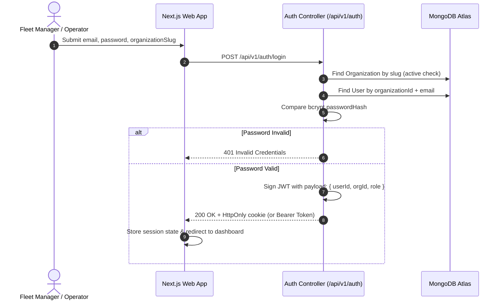

# Authentication & Role-Based Access Control (RBAC) — FleetOS

## 1. Authentication Lifecycle (Mermaid)

---

## 2. Role-Based Access Matrix

| Role | Organization Scope | Fleet & Vehicles | Shipments & Dispatch | Telemetry Map | Invoices & Billing | Audit Logs |
|---|---|---|---|---|---|---|
| **PLATFORM_SUPER_ADMIN** | Global / All Tenants | Full Access | Full Access | Full Access | Full Access | Full Access |
| **ORGANIZATION_ADMIN** | Tenant Only | Full Access | Full Access | Full Access | Full Access | Full Access |
| **DISPATCH_MANAGER** | Tenant Only | View Assets | Create, Assign, Dispatch | Full Access | View Only | View Operations |
| **FLEET_MANAGER** | Tenant Only | Manage Vehicles & Drivers | View Shipments | View Fleet | Maintenance & Fuel | View Operations |
| **DRIVER** | Assigned Assets | View Assigned Vehicle | View Assigned Shipment | Self-Location Only | None | None |
| **CUSTOMER** | Shipment Scope | None | View Own Tracking Number | Track Active Order | View Invoices | None |

