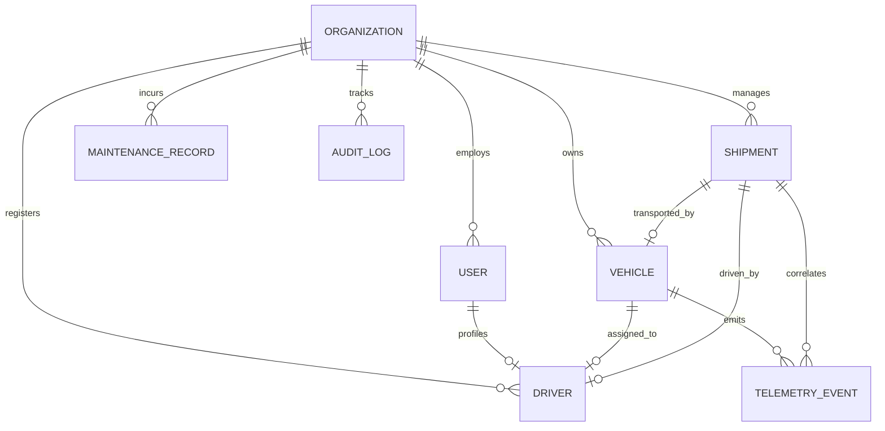

# Database Design & Entity Relationships — FleetOS

## 1. Multi-Tenant Relational Overview

---

## 2. Key Entities Specification

### 1. `Organization`
- **Purpose:** Represents the tenant boundary (e.g. logistics carrier or 3PL company).
- **Core Fields:** `_id`, `name`, `slug` (unique subdomain/code), `plan` (`STARTER`, `GROWTH`, `ENTERPRISE`), `status` (`ACTIVE`, `SUSPENDED`), `settings`.
- **Indexing:** `{ slug: 1 }` (unique).

### 2. `User`
- **Purpose:** Operator, manager, driver, or customer account.
- **Tenant Scope:** Scoped to `organizationId`.
- **Core Fields:** `organizationId`, `email`, `passwordHash`, `role`, `firstName`, `lastName`, `status`.
- **Indexing:** `{ organizationId: 1, email: 1 }` (unique compound index).

### 3. `Vehicle`
- **Purpose:** Commercial fleet asset (Semi-truck, Cargo Van, Box Truck, Flatbed).
- **Tenant Scope:** Mandatory `organizationId`.
- **Core Fields:** `organizationId`, `vin`, `plateNumber`, `make`, `modelName`, `year`, `capacityKg`, `status`, `odometerKm`.
- **Indexing:** `{ organizationId: 1, plateNumber: 1 }` (unique), `{ organizationId: 1, vin: 1 }` (unique).

### 4. `Driver`
- **Purpose:** Certified CDL drivers operating fleet vehicles.
- **Tenant Scope:** Mandatory `organizationId`.
- **Core Fields:** `organizationId`, `userId`, `licenseNumber`, `licenseExpiry`, `assignedVehicleId`, `status`, `rating`.
- **Indexing:** `{ organizationId: 1, licenseNumber: 1 }` (unique), `{ organizationId: 1, userId: 1 }`.

### 5. `Shipment`
- **Purpose:** Freight orders moving between origin and destination.
- **Tenant Scope:** Mandatory `organizationId`.
- **Core Fields:** `organizationId`, `trackingNumber`, `vehicleId`, `driverId`, `status`, `origin`, `destination`, `cargo`, `pricing`, `proofOfDelivery`.
- **Indexing:** `{ organizationId: 1, trackingNumber: 1 }` (unique), `{ trackingNumber: 1 }` (global customer tracking).

### 6. `TelemetryEvent`
- **Purpose:** High-frequency GPS telemetry breadcrumbs.
- **Tenant Scope:** Mandatory `organizationId`.
- **Core Fields:** `organizationId`, `vehicleId`, `shipmentId`, `latitude`, `longitude`, `speedKmh`, `headingDeg`, `isSimulated`, `timestamp`.
- **Indexing:** `{ organizationId: 1, vehicleId: 1, timestamp: -1 }`.

