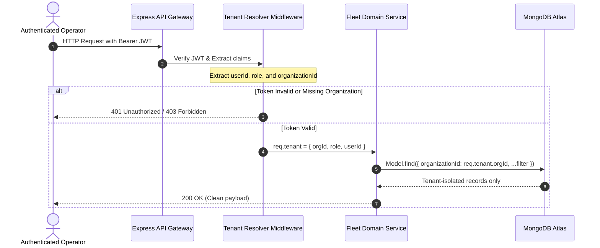

# Multi-Tenant Strategy — FleetOS

## 1. Multi-Tenant Philosophy
FleetOS adopts a **SaaS Shared Database with Logical Tenant Segregation** approach. This maximizes hardware efficiency while guaranteeing bulletproof isolation via multi-layer controls.

---

## 2. Tenant Isolation Sequence (Mermaid)

---

## 3. Defense-in-Depth Tenant Rules
1. **No Queries Without `organizationId`:** Every controller/service must explicitly append `{ organizationId: req.tenant.orgId }` to reads, updates, and deletes.
2. **Compound Unique Constraints:** Unique fields (e.g. `plateNumber` or `email`) are never globally unique across competing carriers; they are unique only within `{ organizationId: 1, field: 1 }`.
3. **Socket.IO Room Partitioning:** Live telemetry broadcasts emit strictly to `io.to("org:" + orgId).emit(...)`.

