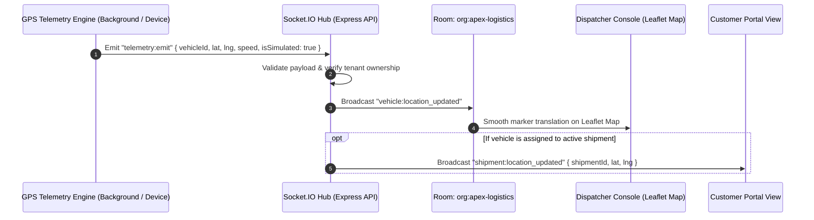

# Real-Time Telemetry & Socket.IO Architecture — FleetOS

## 1. Real-Time Telemetry Flow (Mermaid)

---

## 2. Transparent GPS Simulation Policy
- Because production hardware ELD / OBD-II devices are not attached during local evaluations, all simulated coordinates are stamped with:
  `isSimulated: true`
- The user interface explicitly presents an amber pill: **"SIMULATED GPS STREAM"** to adhere to honest engineering standards and avoid misleading claims.

