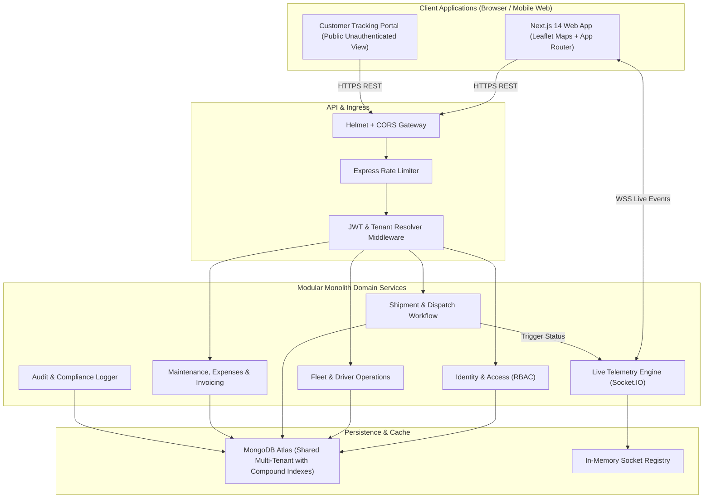

# System Architecture — FleetOS Enterprise Fleet & Logistics SaaS

## 1. Architectural Philosophy
FleetOS is architected as a modular monolith. It prioritizes:
- **Low Operational Complexity:** Avoids premature microservice boundaries while maintaining strict internal domain decoupling.
- **Tenant Isolation by Construction:** Shared database architecture with mandatory organization scopes at database indexes and middleware layers.
- **Event-Driven Telemetry:** HTTP REST APIs for CRUD operations paired with bidirectional Socket.IO pipelines for live telemetry and shipment tracking.

---

## 2. High-Level Architectural Flow (Mermaid)

---

## 3. Communication Protocols
- **Client to Backend (Command / Query):** RESTful JSON APIs over TLS (HTTPS).
- **Client to Backend (Live Telemetry):** Bidirectional WebSockets via Socket.IO with token-authenticated handshake and organization room namespaces (`org:<orgId>`).
- **Telemetry Simulation:** Background GPS simulation worker delivering interpolated coordinates along realistic highway waypoints.

