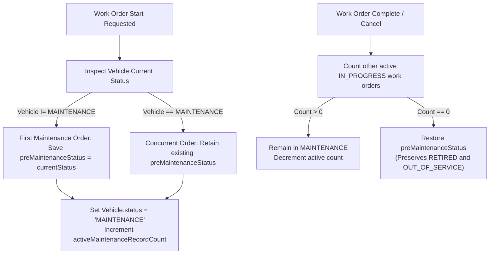

# FleetOS — Maintenance Locks & Vehicle State Safety

## 1. Overview
Vehicle Maintenance in FleetOS requires strict asset state safety to prevent operational conflicts across dispatch manifests, fleet allocations, and maintenance bays.

Previously, completing or cancelling a maintenance work order unconditionally set `Vehicle.status = 'AVAILABLE'`. This presented severe business risks:
- Out-of-service vehicles (`OUT_OF_SERVICE`) were inadvertently promoted to active status.
- Decommissioned / retired vehicles (`RETIRED`) were made available for commercial dispatch.
- When multiple concurrent maintenance orders were underway on a single vehicle, completing the first order prematurely released the vehicle while other maintenance was still `IN_PROGRESS`.

## 2. MaintenanceLock Architecture

FleetOS 07.1 introduces the centralized `MaintenanceLockService`:

## 3. Guarantees & Invariants
1. **Preservation of Non-Operational States**:
   - Vehicles marked `OUT_OF_SERVICE` or `RETIRED` remain in their original status upon maintenance completion or cancellation.
2. **Concurrent Order Isolation**:
   - If Work Order A and Work Order B are both `IN_PROGRESS` on the same vehicle, completing Work Order A keeps the vehicle locked to `MAINTENANCE`. The vehicle is only unlocked when the final active work order finishes.
3. **Dispatch Allocation Protection**:
   - The dispatch engine (`DispatchController`) strictly rejects vehicles with `status === 'MAINTENANCE'`, ensuring vehicles undergoing service are never dispatched on freight runs.
