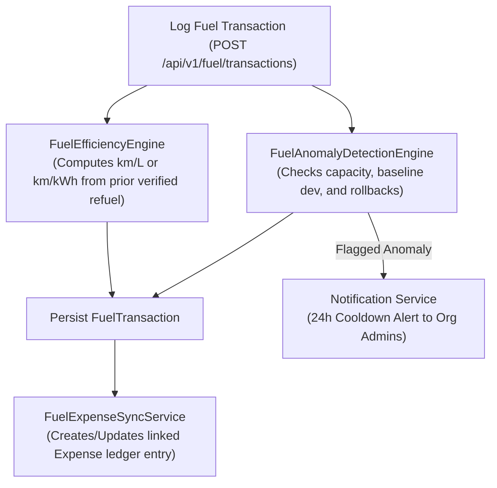

# FleetOS — Phase 08: Fuel Management & Cost Analytics

## 1. Overview
The Fuel Management module provides carrier-grade fuel tracking, real-time consumption calculations, electric vehicle kWh metrics, automatic financial expense synchronization, and anomaly audits.

## 2. Architecture & Data Flow

## 3. Fuel Efficiency Engine
- **Liquid Fuel:** Calculated as `Distance Travelled (km) / Fuel Volume (L)`.
- **Electric Vehicles (EV):** Calculated as `Distance Travelled (km) / Energy (kWh)`.
- **Decreasing Odometer Guard:** If `currentOdometer < previousOdometer`, efficiency is marked `UNAVAILABLE` and an anomaly flag `ODOMETER_ROLLBACK` is raised.
- **Initial Baseline:** The first refuel establishes baseline mileage without estimating unverified distance.

## 4. Expense Integration
- Every verified FuelTransaction automatically creates an Expense record with category `FUEL`.
- Traceability: `Expense.fuelTransactionId` links back to `FuelTransaction._id`.
- Idempotency: Multiple sync passes update the existing expense without creating duplicates.
- Void Lifecycle: Voiding a fuel transaction automatically marks the linked Expense as `isVoided = true`.
