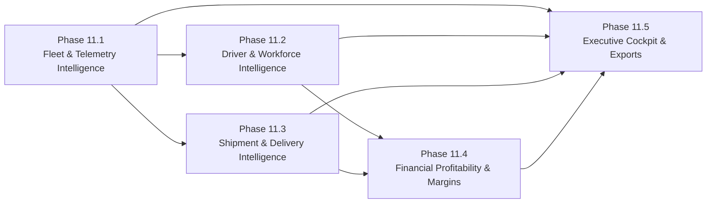

# FLEETOS — PHASE 11 IMPLEMENTATION ROADMAP
**Date:** November 12, 2026
**Author:** Principal Software Architect, QA Lead & CTO
**Repository:** `d:\portfolio-projects\fleetos-enterprise-saas` (`arifranabk3/fleetos-enterprise`)
**Baseline Git Commit:** `57d004326293f52740af62716fc61d1100344d2c`

---

## 1. ROADMAP PHILOSOPHY & SEQUENCING

Phase 11 introduces comprehensive intelligence and operational analytics across the FLEETOS enterprise platform. To avoid monolithic regressions, manage dependencies cleanly, and maintain continuous automated testability, Phase 11 is structured into **5 distinct, dependency-aware subphases**:

---

## 2. SUBPHASE SPECIFICATIONS

---

### SUBPHASE 11.1 — FLEET UTILIZATION, ASSET & TELEMETRY INTELLIGENCE

- **Business Objective:** Provide carriers with real-time and historical visibility into vehicle fleet availability, operational utilization %, idle-time fuel waste, and maintenance impact on fleet capacity.
- **Dependencies:** `Vehicle`, `TelemetryEvent`, `Dispatch`, `MaintenanceRecord`.
- **Backend Components:**
  - `FleetAnalyticsService.ts`: Aggregation pipelines for vehicle utilization, idle analysis, and availability distribution.
  - `FleetAnalyticsController.ts`: Handles requests, validates tenant context and date filters.
  - Index migrations for `{ organizationId: 1, status: 1, type: 1 }` and `{ organizationId: 1, vehicleId: 1, recordedAt: -1, motionStatus: 1 }`.
  - Route additions to `backend/src/routes/fleetRoutes.ts`.
- **Frontend Components:**
  - Refactor `/fleet` to include utilization metrics.
  - New route: `/analytics/fleet/page.tsx` with interactive utilization charts, idle breakdown, and vehicle category distribution.
- **RBAC Permissions:** `ANALYTICS:VIEW_FLEET`.
- **Acceptance Criteria:**
  1. Accurately calculates fleet utilization % over arbitrary date windows (7D, 30D, 90D).
  2. Measures total idle hours vs moving hours from `TelemetryEvent`.
  3. Clearly identifies simulated vs hardware GPS data sources.
  4. 100% tenant-isolated with zero cross-tenant data leakage.
  5. Dedicated test suite: `backend/src/tests/fleet_analytics.test.ts`.

---

### SUBPHASE 11.2 — DRIVER WORKFORCE PERFORMANCE & SAFETY INTELLIGENCE

- **Business Objective:** Deliver an enterprise driver performance portal that measures shift attendance reliability, safety incident impact, and productivity without duplicating Phase 09 workforce features.
- **Dependencies:** `Driver`, `DriverShift`, `DriverIncident`, `Shipment`, `DriverPerformanceEngine`.
- **Backend Components:**
  - `DriverAnalyticsService.ts`: Extends `DriverPerformanceEngine` for multi-driver fleet comparative rankings, historical trend rolling windows, and attendance reliability metrics.
  - `DriverAnalyticsController.ts`: Handles fleet leaderboard, driver scorecard trends, and safety analysis.
  - Route additions to `backend/src/routes/driverWorkforceRoutes.ts`.
- **Frontend Components:**
  - Refactor `/driver-analytics/page.tsx` to connect to real backend endpoints.
  - Add individual driver historical performance trend line chart in `/drivers/[id]/performance/page.tsx`.
- **RBAC Permissions:** `ANALYTICS:VIEW_DRIVERS`.
- **Acceptance Criteria:**
  1. Fleet leaderboard accurately sorts drivers by composite performance score (0-100).
  2. Attendance reliability correctly incorporates scheduled, completed, and late-start shifts.
  3. Only resolved, driver-responsible safety incidents penalize scorecards.
  4. Drivers can only view their own performance metrics; managers can view all tenant drivers.
  5. Dedicated test suite: `backend/src/tests/driver_analytics.test.ts`.

---

### SUBPHASE 11.3 — SHIPMENT, DELIVERY & LANE SERVICE-LEVEL INTELLIGENCE

- **Business Objective:** Analyze freight velocity, on-time delivery percentages, delivery delay durations, high-volume shipping corridors (lanes), and customer delivery SLA compliance.
- **Dependencies:** `Shipment`, `Dispatch`, `Customer`, `Route`.
- **Backend Components:**
  - `ShipmentAnalyticsService.ts`: Aggregations for on-time delivery rate, delay variances, lane tonnage distributions, and delivery failure categorization.
  - `ShipmentAnalyticsController.ts`: API endpoints for SLA performance, freight corridor volume, and failure diagnostics.
  - Compound index: `{ organizationId: 1, status: 1, 'proofOfDelivery.deliveredAt': -1 }`.
  - Route additions to `backend/src/routes/logisticsRoutes.ts`.
- **Frontend Components:**
  - New route: `/analytics/shipments/page.tsx` with on-time delivery KPI cards, lane volume bar charts, and SLA delay histograms.
- **RBAC Permissions:** `ANALYTICS:VIEW_SHIPMENTS`.
- **Acceptance Criteria:**
  1. On-time delivery rate calculated strictly from `proofOfDelivery.deliveredAt <= expectedDeliveryDate`.
  2. Delayed shipments calculate exact mean delay duration in minutes.
  3. Lane volume groups shipments by origin-destination city/state corridor.
  4. Delivery failure diagnostics categorize failures based on proof-of-delivery notes and exception records.
  5. Dedicated test suite: `backend/src/tests/shipment_analytics.test.ts`.

---

### SUBPHASE 11.4 — FINANCIAL PROFITABILITY & OPERATING MARGIN INTELLIGENCE

- **Business Objective:** Unify accounting revenues with operational costs (fuel, maintenance, driver compensation) to provide vehicle and customer profitability insights without creating a duplicate ledger.
- **Dependencies:** `Invoice`, `DriverSettlement`, `FuelTransaction`, `Expense`, `MaintenanceRecord`, `FinancialReportingService`.
- **Backend Components:**
  - `ProfitabilityEngine.ts`: Calculates vehicle gross contribution, operating expense ratios (OER), customer profitability margins, and cost-per-km metrics.
  - `ProfitabilityController.ts`: API endpoints for vehicle, customer, and lane profitability matrices.
  - Route additions to `backend/src/routes/financialReportRoutes.ts`.
- **Frontend Components:**
  - New route: `/analytics/profitability/page.tsx` with vehicle profitability table, customer gross margin rankings, and operating expense breakdown.
- **RBAC Permissions:** `ANALYTICS:VIEW_FINANCIAL`.
- **Acceptance Criteria:**
  1. Revenue figures strictly match posted invoices from Phase 10 (no double-counting or unbilled estimation).
  2. Operating costs accurately sum recorded fuel transactions, maintenance records, and driver settlements.
  3. Clearly distinguishes exact accounting figures from analytical margin estimates in API outputs and UI labels.
  4. Multi-currency awareness: groups results by currency with zero cross-currency mathematical sums.
  5. Dedicated test suite: `backend/src/tests/profitability_analytics.test.ts`.

---

### SUBPHASE 11.5 — EXECUTIVE INTELLIGENCE COCKPIT & REPORTING CENTER

- **Business Objective:** Provide C-suite fleet executives and business owners with a unified operational overview, anomaly alerts hub, and exportable executive intelligence briefs.
- **Dependencies:** All Phase 11 services, `Notification`, `TelemetryAlert`, `AuditLog`.
- **Backend Components:**
  - `ExecutiveIntelligenceService.ts`: Consolidated executive overview aggregator, anomaly alert coordinator, and CSV/PDF export generator.
  - `ExecutiveAnalyticsController.ts`: Top-level dashboard endpoints and export handlers.
  - CWE-1236 CSV sanitization and audit logging on all report downloads.
- **Frontend Components:**
  - Overhaul `/dashboard/page.tsx` to display live operational metrics from `ExecutiveIntelligenceService`.
  - Refactor `/analytics/page.tsx` into the Executive Intelligence Cockpit.
  - New route: `/analytics/alerts/page.tsx` for operational anomaly detection and acknowledgement.
- **RBAC Permissions:** `ANALYTICS:VIEW_EXECUTIVE`, `ANALYTICS:EXPORT_REPORTS`.
- **Acceptance Criteria:**
  1. Main dashboard reflects real live data from MongoDB collections (zero hardcoded mock data).
  2. Executive summary cards load in < 250ms P95.
  3. Operational alerts aggregate active anomalies across telemetry, fuel, maintenance, and shipments.
  4. CSV and PDF exports are properly sanitized, tenant-isolated, and logged to `AuditLog`.
  5. Dedicated test suite: `backend/src/tests/executive_analytics.test.ts`.

---

## 3. ROLLBACK & RISK MITIGATION STRATEGY

- **Zero Breaking Changes:** Phase 11 is strictly additive. No modifications to operational state machines, invoice lifecycle guards, or existing models will be introduced.
- **Independent Subphases:** Each subphase delivers complete vertical functionality (service, controller, routes, frontend, tests). If any subphase fails automated verification, it can be isolated or rolled back without impacting prior completed phases.
- **Backward Compatibility:** All existing 212 automated tests across Phases 02 through 10.4 must continue to pass with 100% success at every step.
