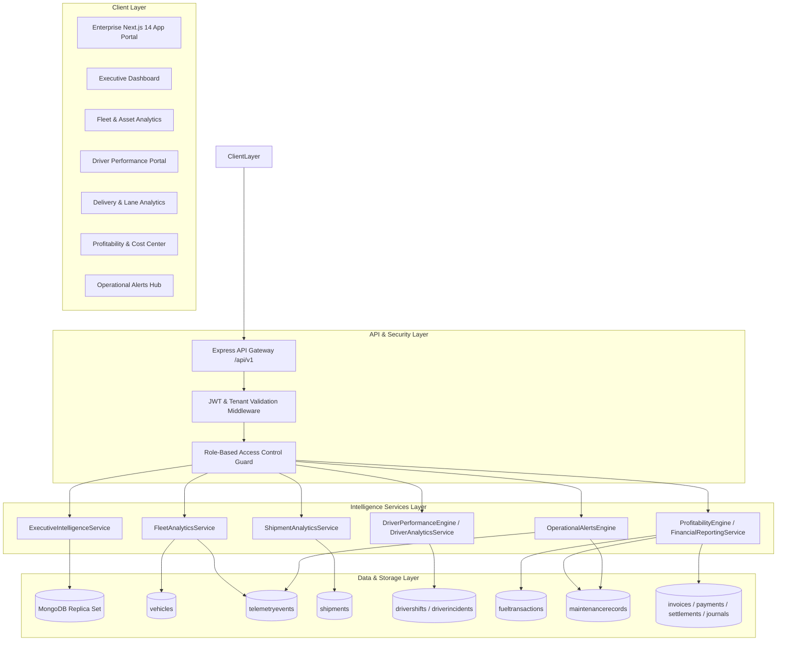

# FLEETOS — PHASE 11 MASTER ARCHITECTURE
**Date:** November 12, 2026
**Author:** Principal Software Architect & CTO
**Repository:** `d:\portfolio-projects\fleetos-enterprise-saas` (`arifranabk3/fleetos-enterprise`)
**Target Milestone:** Phase 11 — Enterprise Intelligence, Analytics & Operational Observability
**Baseline Commit:** `57d004326293f52740af62716fc61d1100344d2c`

---

## 1. ARCHITECTURAL VISION & PURPOSE

Phase 11 transforms FLEETOS from an operational execution and financial transactional platform into an **intelligent enterprise fleet control system**.

By federating real-time telemetry, shipment dispatch lifecycle events, driver safety/attendance records, maintenance logs, and double-entry financial ledgers, Phase 11 delivers:

1. **Fleet Utilization & Asset Intelligence:** Total visibility into vehicle operating hours, idle waste, availability ratios, and maintenance impact.
2. **Driver Workforce & Safety Intelligence:** Holistic driver performance scoring, risk heatmaps, shift reliability, and cost-to-productivity metrics.
3. **Shipment & Delivery Service-Level Intelligence:** Lane efficiency, delay diagnostics, customer delivery SLAs, and dispatch cadences.
4. **Unified Profitability & Operating Margin Intelligence:** Ground-truth accounting revenues cross-referenced with operational fuel, maintenance, and driver labor costs.
5. **Operational Proactive Anomaly Detection & Alerts:** Early-warning indicators for fuel theft, extreme idling, overdue maintenance risk, and shipment SLA breaches.
6. **Executive C-Suite Operations Cockpit:** High-level executive KPIs, trend forecasting via explainable deterministic models, and enterprise-grade PDF/CSV export reporting.

---

## 2. MODULAR MONOLITH INTEGRATION ARCHITECTURE

FLEETOS adheres strictly to its proven **modular monolith architecture**. Phase 11 introduces a cohesive analytics domain without breaking architectural boundaries or creating duplicate data stores.

---

## 3. PROPOSED MODULE ARCHITECTURE

### Module A: Fleet Intelligence (`FleetAnalyticsService`)
- **Objectives:** Measure fleet asset utilization, idle-time penalties, availability ratios, and maintenance impact.
- **Key Metrics:**
  - `activeFleetCount`, `inTransitCount`, `availableCount`, `maintenanceCount`, `outOfServiceCount`.
  - `fleetUtilizationRatePercent`: `(Operating Hours / Total Fleet Active Hours) * 100`.
  - `totalIdleHours`: Aggregated from `TelemetryEvent.motionStatus === 'IDLE'`.
  - `costPerKm`: Maintenance cost + fuel cost per vehicle per kilometer driven.
  - `availabilityRatio`: Vehicles operational vs total fleet.
- **Controller & Endpoints:**
  - `GET /api/v1/analytics/fleet/utilization?startDate=&endDate=&vehicleType=`
  - `GET /api/v1/analytics/fleet/vehicles/:id/performance?days=30`
  - `GET /api/v1/analytics/fleet/idle-analysis?days=30`

### Module B: Driver Performance Intelligence (`DriverAnalyticsService`)
- **Objectives:** Enterprise driver ranking, shift compliance, safety risk scoring, and productivity per driver hour.
- **Key Metrics:**
  - Composite Driver Score (0-100) using `DriverPerformanceEngine`.
  - On-time delivery rate per driver.
  - Incident severity frequency & exoneration tracking.
  - Shift attendance reliability (% completed on-time vs late/missed).
  - Total labor cost per kilometer and per shipment delivered.
- **Controller & Endpoints:**
  - `GET /api/v1/analytics/drivers/performance-matrix?startDate=&endDate=`
  - `GET /api/v1/analytics/drivers/leaderboard?period=30`
  - `GET /api/v1/analytics/drivers/:id/historical-trend?months=6`

### Module C: Shipment & Delivery Intelligence (`ShipmentAnalyticsService`)
- **Objectives:** Dispatch efficiency, SLA breach analysis, lane-by-lane velocity, customer turnaround times, and delivery failure root causes.
- **Key Metrics:**
  - `onTimeDeliveryRatePercent`: Shipments delivered on or before `expectedDeliveryDate`.
  - `averageDeliveryDelayMinutes`: Mean variance for late deliveries.
  - `failedDeliveryBreakdown`: Grouped by failure reason notes.
  - `freightTonnageByLane`: Origin city/state to destination city/state aggregation.
  - `customerSLACompliance`: Customer-level delivery success metrics.
- **Controller & Endpoints:**
  - `GET /api/v1/analytics/shipments/sla-performance?startDate=&endDate=`
  - `GET /api/v1/analytics/shipments/lane-analytics?days=30`
  - `GET /api/v1/analytics/shipments/failure-reasons?days=90`

### Module D: Financial Profitability & Operating Margins (`ProfitabilityEngine`)
- **Objectives:** Multi-dimensional profitability without creating a duplicate ledger. Synthesizes posted invoice revenue with operational expenses.
- **Integrations:** Links `Invoice` (billed revenue), `DriverSettlement` (driver pay), `FuelTransaction` / `Expense` (fuel), and `MaintenanceRecord` (maintenance).
- **Key Metrics:**
  - `grossRevenueByVehicle`: Revenue generated by shipments assigned to a vehicle.
  - `operatingCostByVehicle`: Maintenance + fuel expenses for that vehicle.
  - `netVehicleContribution`: Gross Revenue - Operating Cost.
  - `profitabilityByCustomer`: Billed customer revenue vs estimated customer shipment direct costs.
  - `operatingExpenseRatio (OER)`: `(Operating Costs / Total Freight Revenue) * 100`.
- **Controller & Endpoints:**
  - `GET /api/v1/analytics/profitability/vehicles?startDate=&endDate=`
  - `GET /api/v1/analytics/profitability/customers?startDate=&endDate=`
  - `GET /api/v1/analytics/profitability/lanes?startDate=&endDate=`
  - `GET /api/v1/analytics/profitability/summary?startDate=&endDate=&currency=`

### Module E: Operational Alerts & Anomaly Center (`OperationalAlertsEngine`)
- **Objectives:** Proactive detection of operational and financial exceptions before they cause financial loss or service disruption.
- **Capabilities:**
  - Telemetry anomalies (extreme speed, prolonged idling > 60m, offline GPS).
  - Fuel anomalies (fuel volume > tank capacity, zero-distance refuels, sudden MPG drop).
  - Maintenance compliance alerts (overdue DOT inspection, high-priority maintenance pending).
  - Delivery SLA breach warning (shipments in transit whose expected delivery date is within 2 hours without delivery milestone).
- **Controller & Endpoints:**
  - `GET /api/v1/analytics/alerts/active`
  - `POST /api/v1/analytics/alerts/:id/acknowledge`
  - `GET /api/v1/analytics/alerts/trends?days=30`

### Module F: Executive Intelligence & C-Suite Cockpit (`ExecutiveIntelligenceService`)
- **Objectives:** Consolidated high-level executive dashboard delivering strategic KPIs, cross-domain trends, and board-ready exportable reports.
- **Capabilities:**
  - Executive KPI summary card strip (Total Revenue, Active Fleet %, On-Time Delivery %, Open Incidents, Unresolved Alerts).
  - 12-month trailing operational and financial trends.
  - Comprehensive PDF and sanitized CSV export generating downloadable executive briefs.
- **Controller & Endpoints:**
  - `GET /api/v1/analytics/executive/overview?period=month`
  - `GET /api/v1/analytics/executive/trends?year=2026`
  - `GET /api/v1/analytics/executive/export/csv?startDate=&endDate=`
  - `GET /api/v1/analytics/executive/export/pdf?startDate=&endDate=`

---

## 4. UI/UX ARCHITECTURE & COMPONENT SYSTEM

The Phase 11 user interface integrates seamlessly into FLEETOS's existing Tailwind CSS and Lucide-React design system:

### Route Structure
1. `/dashboard` — Refactored to display live operational cockpit backed by real API endpoints (replacing demo simulation mocks).
2. `/analytics` — Executive Intelligence & Cross-Fleet Performance.
3. `/analytics/fleet` — Fleet Utilization, Availability & Operating Costs.
4. `/analytics/shipments` — Shipment SLAs, Lane Velocity & Delivery Performance.
5. `/analytics/profitability` — Revenue vs Operating Cost Breakdown by Vehicle & Customer.
6. `/analytics/alerts` — Real-Time Operational Anomaly Hub.
7. `/driver-analytics` — Enhanced with multi-driver comparative matrix and shift reliability trends.

### Reusable UI Analytics Components
- `MetricCard`: Reusable KPI card with trend delta, format options (currency, percentage, duration), and loading skeletons.
- `BarChartCard`: Accessible SVG/CSS-driven horizontal & vertical comparative bar visualizer.
- `TrendLineCard`: Clean, zero-external-dependency SVG responsive time-series chart component.
- `DateRangePicker`: Uniform date window selector (`7D`, `30D`, `90D`, `YTD`, `Custom`).
- `CurrencySelector`: Multi-tenant currency switcher for financial intelligence.
- `SimulatedDataBadge`: Visible indicator when viewing data containing simulated GPS telemetry.
- `DataTableWithExport`: Paginated data grid with sanitized CSV and PDF download actions.

---

## 5. ZERO-COST ARCHITECTURAL COMPLIANCE

| Proposed Capability | Implementation Mechanism | Cost Classification |
| :--- | :--- | :--- |
| Database Aggregations | MongoDB native pipeline (`$match`, `$group`, `$facet`) | **Already Available (Free)** |
| Real-time Alerts | Existing Socket.IO infrastructure + MongoDB indexes | **Already Available (Free)** |
| Interactive Visualizations | Custom SVG / Tailwind React components (or existing Lucide icons) | **Already Available (Free)** |
| CSV Report Generation | In-house sanitized RFC-4180 CSV serializer | **Already Available (Free)** |
| PDF Export | Server-side HTML print stylesheet / headless template | **Already Available (Free)** |
| Map Visualizations | Existing Leaflet / OpenStreetMap integration | **Already Available (Free)** |
| Predictive Insights | Explainable statistical algorithms (Moving Averages, Linear Trends) | **Already Available (Free)** |
